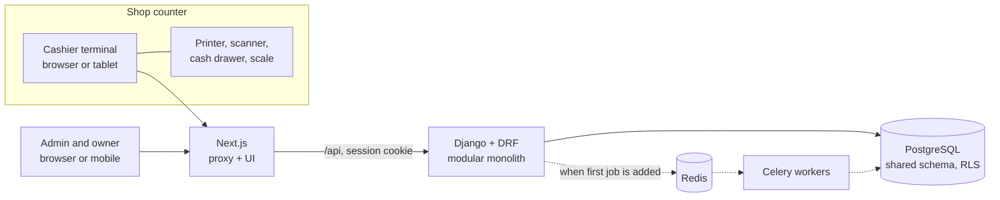
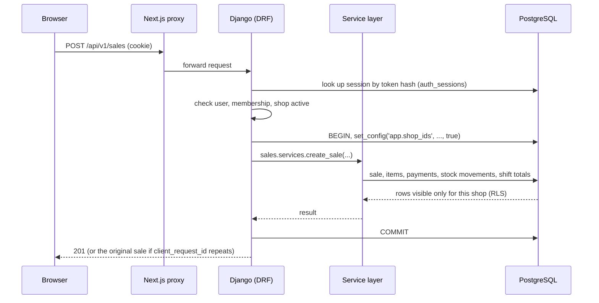

# Architecture

How the system fits together. The reasons behind each choice are in `DECISIONS.md`; the tables are in `ER-DIAGRAM.md` and `DATA-DICTIONARY.md`; the API conventions are in `CONTRACTS.md`.

## 1. Overview

- The browser talks **only to Next.js**, which forwards API calls to Django. No CORS for the web app.
- Native clients (Android tablet, owner mobile app) call Django directly with a Bearer token.
- Redis and Celery arrive with the first background job (M12). Dotted lines are not part of the MVP.
- Hardware (printers, scanner, drawer, scale) connects at the counter. Receipts, drawer and cutter go through a small local print service, or WebUSB where supported (D-027).
- External services: MFS (bKash, Nagad, Rocket) start as a manually entered transaction ID. SMS and email are deferred.

## 2. Modules

One Django project, one deployable. Each domain is a Django app under `backend/apps/`.

| App | Owns these tables | Maintainer |
|---|---|---|
| `accounts` | users, shop_types, shops, branches, registers, roles, permissions, role_permissions, memberships, membership_branches, auth_sessions, shifts, cash_movements, z_reports, notifications, number_sequences (16) | BE1 |
| `catalog` | categories, brands, units, tax_rates, attribute_definitions, products, product_variants, variant_barcodes, unit_conversions, combo_items, branch_variants (11) | BE2 |
| `inventory` | stock_batches, stock_levels, stock_movements, stock_adjustment_reasons, stock_adjustments, stock_adjustment_items, stock_counts, stock_count_items, stock_transfers, stock_transfer_items (10) | BE2 |
| `sales` | sales, sale_items, sale_promotions, payment_methods, payments, sale_returns, sale_return_items, expense_categories, expenses, receipt_templates (10) | BE1 |
| `customers` | customer_groups, group_prices, customers, customer_ledger, due_collections, loyalty_transactions, gift_cards, gift_card_transactions (8) | BE2 |
| `purchasing` | suppliers, purchase_orders, purchase_order_items, goods_receipts, goods_receipt_items, purchase_returns, purchase_return_items, supplier_payments, supplier_ledger (9) | BE2 |
| `promotions` | promotions, promotion_targets, coupons, coupon_redemptions (4) | BE1 |
| `audit` | audit_logs, approvals, app_settings_history, notification_logs (deferred) (4) | BE1 |
| `reports` | no tables; read-only queries over the other apps | BE2 |

That is 72 tables, matching `DATA-DICTIONARY.md`.

**Layering.** An app may call the `services.py` (writes) and `selectors.py` (reads) of apps in layers below it, never above:

| Layer | Apps |
|---|---|
| 0 | `accounts`, `audit` |
| 1 | `catalog` |
| 2 | `inventory`, `customers`, `promotions` |
| 3 | `sales`, `purchasing` |
| 4 | `reports` (read-only, through each app's `selectors.py`) |

Rules (checked in CI):
- No app writes to another app's models. Use that app's `services.py`.
- No app imports another app's views or serializers.
- Foreign keys between apps are allowed (for example `sale_items.variant_id`).
- The `shop_id` and `branch_id` of any related object must match (enforced by database constraints, see D-017).

**Other modules and maintainers** (one designated maintainer each; anyone may change a module through a pull request, and its maintainer reviews it):

| Module | Where | Maintainer |
|---|---|---|
| Terminal screens | `frontend/src/app/(terminal)` | FE1 |
| Admin screens | `frontend/src/app/(admin)` | FE2 |
| Shared UI components and design tokens | `frontend/` shared package | FE2 |
| API contract (OpenAPI schema and generated types) | `contracts/` | BE2 |
| Infrastructure, CI/CD, deployment files | `infra/`, `.github/workflows/` | BE1 |
| Load tests | `loadtest/` | BE1 |
| Helper and data scripts | `scripts/` | BE2 |
| Docs | `docs/` | whoever maintains the related module updates its docs |

## 3. Request lifecycle

Key points:
- The shop comes from the verified session and membership, never from the request body (D-004).
- A sale is **one transaction**: bill, lines, payments, stock movements and shift totals succeed or fail together.
- Stock rows are locked (`select_for_update`) while stock is posted, so concurrent sales cannot corrupt quantities.
- Row-level security is the second line of defence: even a code bug cannot read another shop's rows.

## 4. Authentication and sessions

Opaque server-side sessions on `auth_sessions` (D-020): login, choose shop, branch and register, then every request is checked against the session row. Revoking the session ends access on the next request. Details and rules are in `DECISIONS.md` (D-020) and `CLAUDE.md`.

## 5. Data

- One shared PostgreSQL database and schema. Every shop-owned table has `shop_id`; branch-scoped tables also have `branch_id` (D-003).
- Stock and balances are append-only ledgers, with cached balances updated in the same transaction (D-009).
- Completed sales are immutable; sale lines are snapshots (D-010).
- Shop types are configuration: presets, feature flags and custom fields (D-007).
- The application connects as a limited role; migrations run as a separate role (D-004).

## 6. Background work

None in the MVP. From M12, Celery with Redis runs expiry, low-stock, overdue-due and shift-difference alert jobs and writes `notifications`. Jobs must set the shop context themselves. SMS and email sending is deferred (D-015) and would be the first candidate to split into its own service.

## 7. Resilience matrix

What should happen when something fails. Each row needs evidence (a test, a screenshot or a log line) saved in `docs/results/` before launch (TM-02).

| # | Failure | Expected behaviour | Proven in |
|---|---|---|---|
| 1 | Network drops mid-bill | The bill in progress stays on the device, the cashier sees a clear message, and can resume. No duplicate on retry. | F1-05, F1-14 |
| 2 | The same sale is submitted twice | One sale only (`client_request_id` unique per shop) | B1-05 |
| 3 | Browser refresh or power cut mid-bill | The draft bill is restored | F1-05, F1-14 |
| 4 | Two cashiers sell the last unit at once | Stock follows the negative-stock policy and the ledger stays consistent | B2-05, B1-05 |
| 5 | Session revoked mid-bill | Next request returns 401, the draft is kept, login resumes the bill | B1-01, F1-01 |
| 6 | Printer offline or out of paper | The sale stays completed, the error is visible, and reprint is available | F1-06 |
| 7 | Cash drawer does not open | Manual open; no data impact | F1-06 |
| 8 | MFS or card verification fails or stays pending | The payment is recorded as failed or pending and cannot count as paid until resolved (policy to confirm) | B1-05, F1-05 |
| 9 | Database restarts or fails over | Requests fail fast with a clear error; transactions leave no partial writes | B1-14 |
| 10 | Redis or Celery is down | Sales are unaffected; alerts are delayed | B1-12 |
| 11 | A user tries to read another shop's data | Denied by row-level security, even if application code is wrong | B1-00, B1-14 |
| 12 | A migration fails during deploy | The release rolls back; the app role cannot change the schema | B1-14 |
| 13 | Restore from backup | A restore drill meets the recovery target and a single shop can be exported | B2-14 |

## 8. Deployment

Not decided yet: hosting provider and topology. Planned shape:
- Environments: development (Docker on each PC), staging and production.
- The frontend and the backend are built, versioned and deployed **independently** (D-022). The committed OpenAPI contract keeps them compatible: every API change is backward compatible, or uses a new path version. For an additive change, deploy the backend first, then the frontend.
- CI (tests and repository checks, see `SETUP.md`, section D) runs on every pull request, with path filters so a frontend-only change does not rebuild the backend, and the reverse. CD deploys from `main` automatically; the exact targets and any approval step for production are decided in M14.
- Releases must not stop sales (NFR-13). Errors go to central logs and monitoring (M14).
- Backups: daily, kept 30 days, with restore drills (NFR-07).