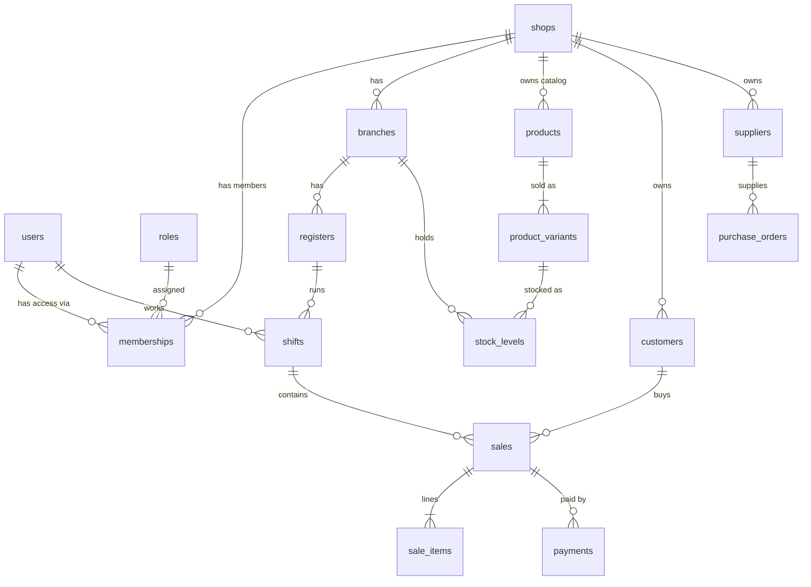
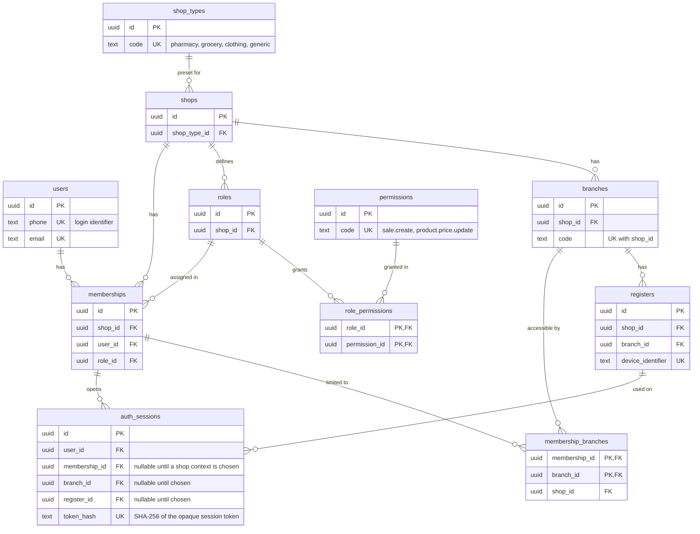
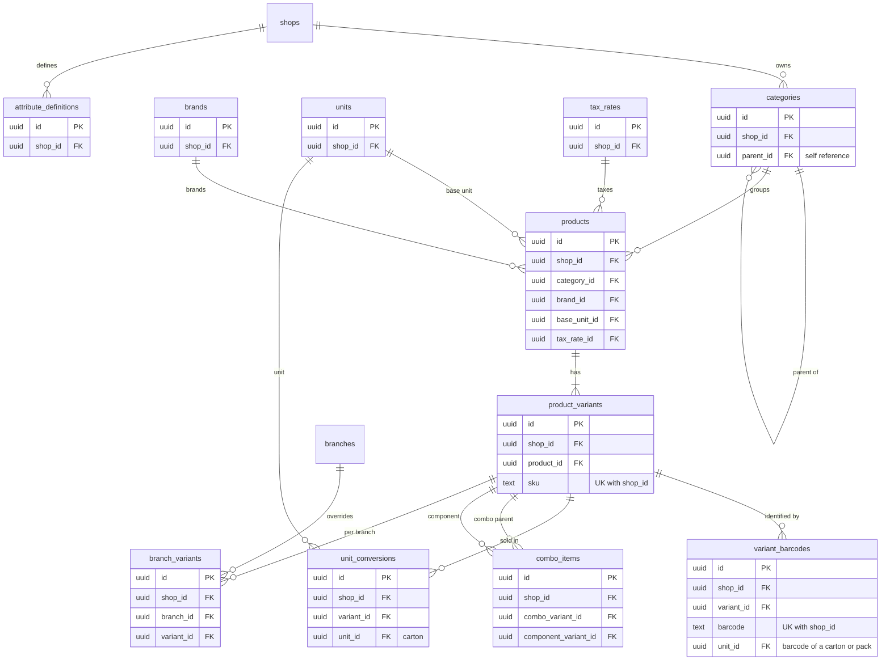
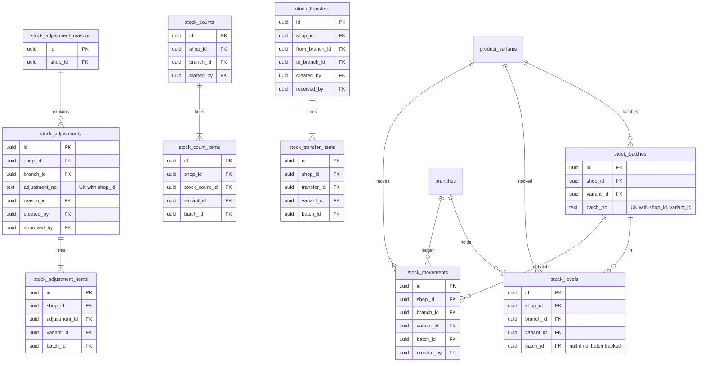
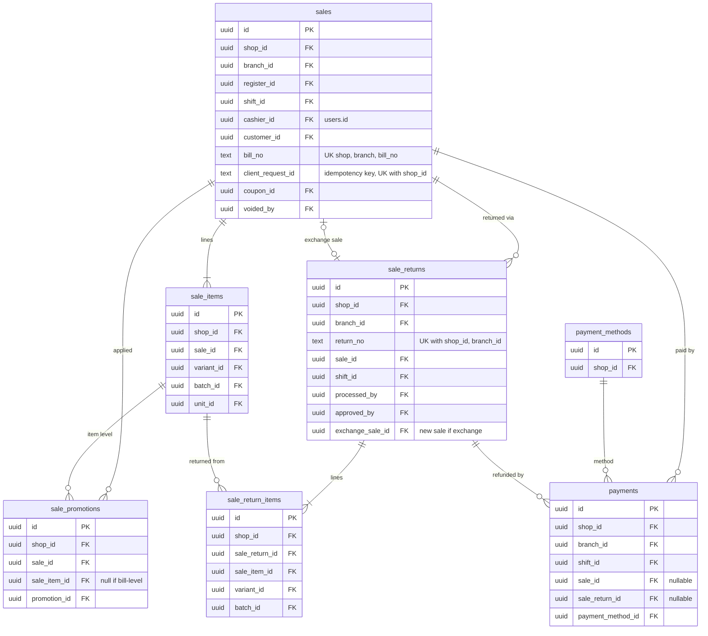
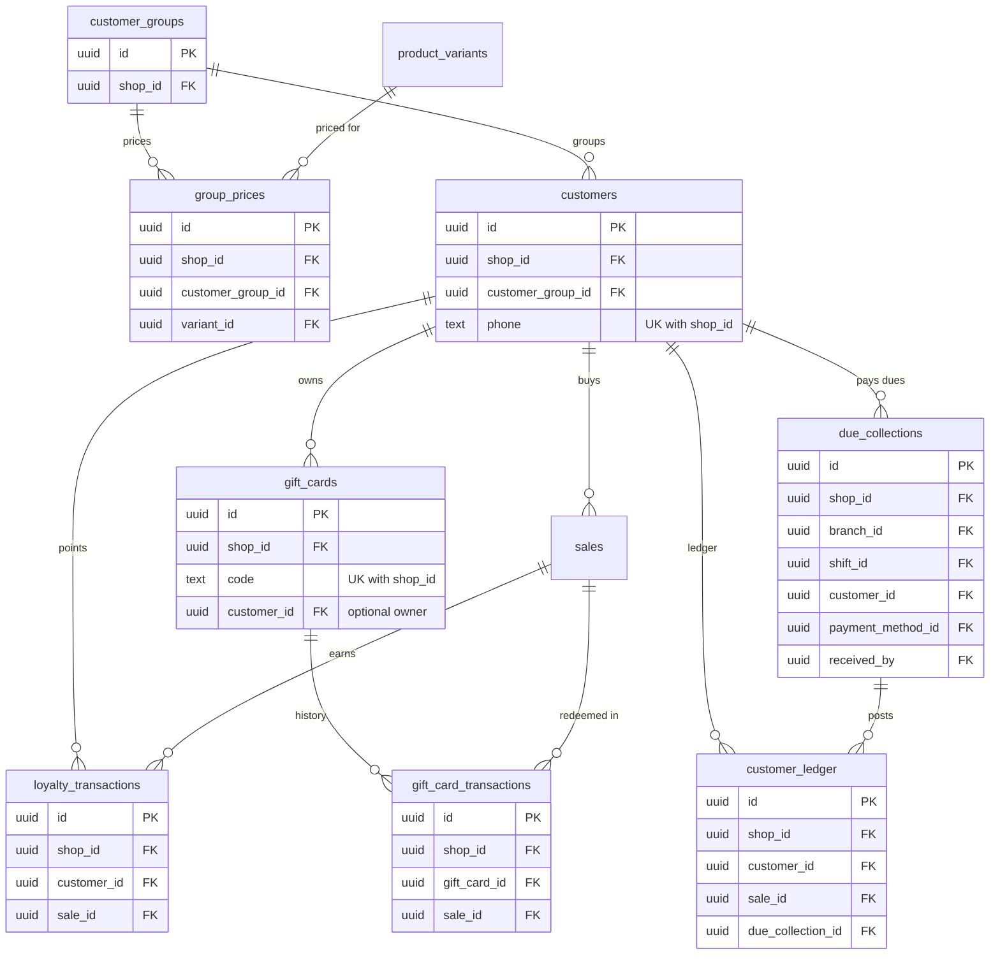
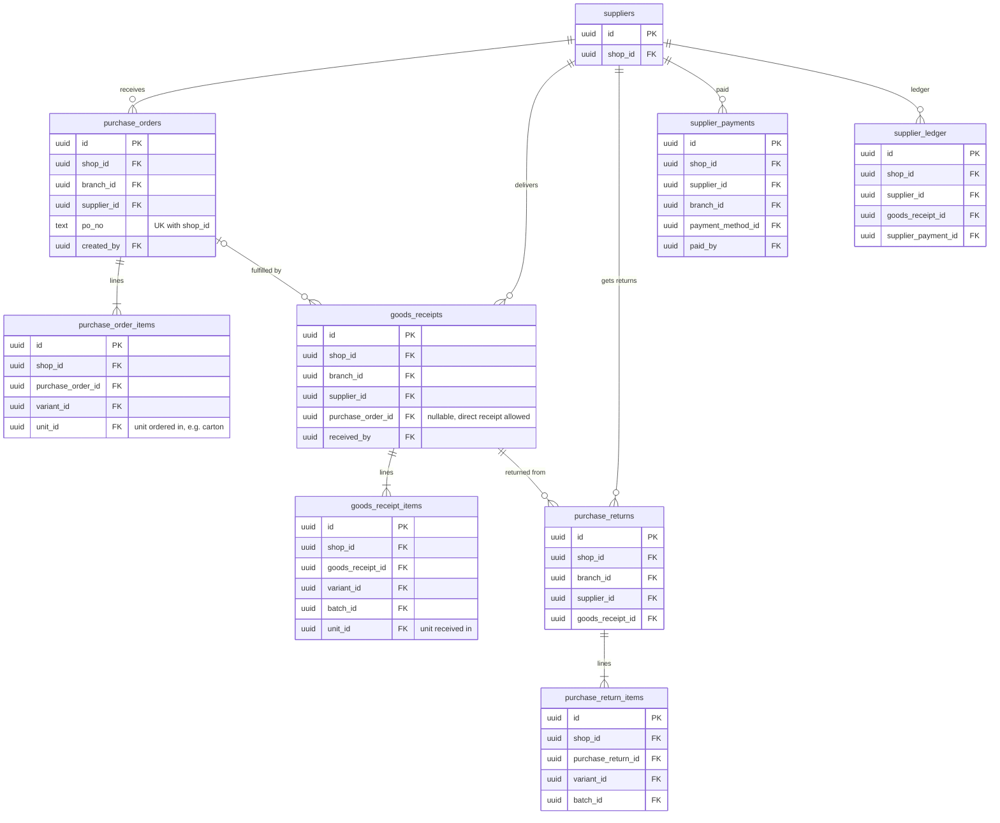
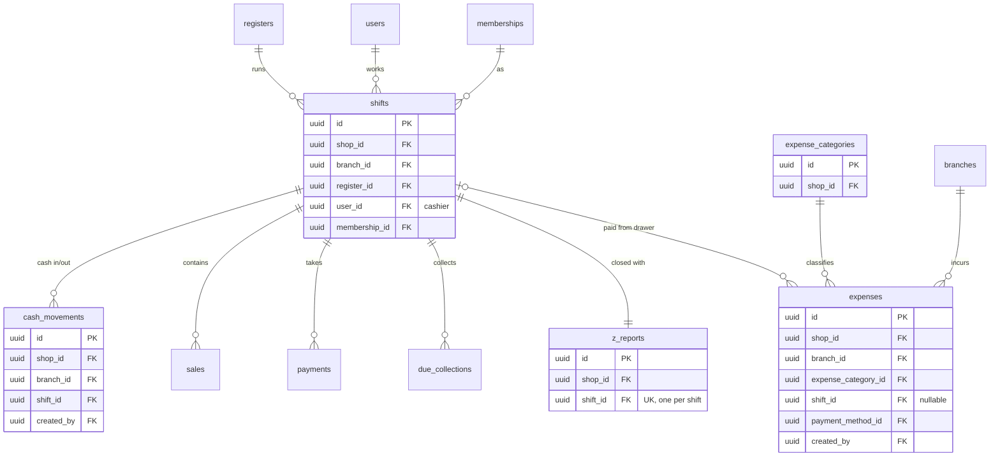
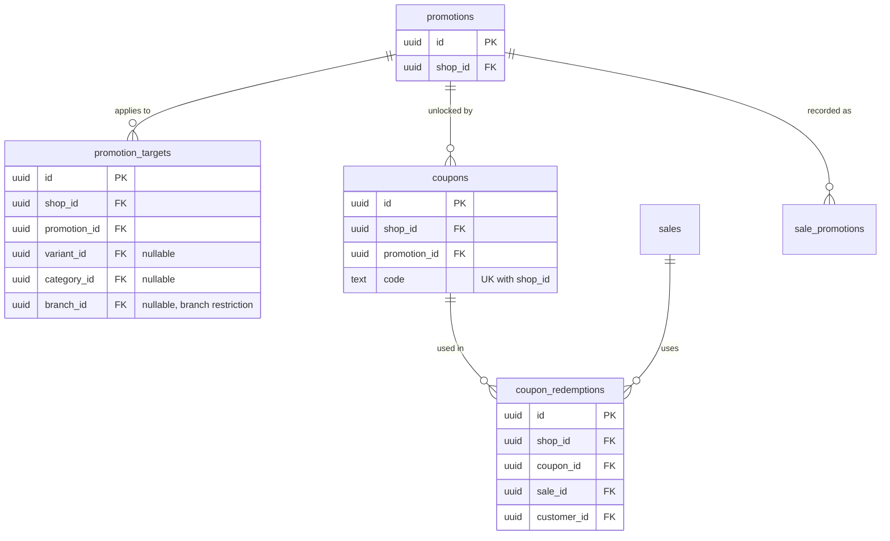

# POS System: Entity Relationship Design (v0.1 draft)

**Status:** For review. SQL (PostgreSQL DDL, RLS policies, indexes) comes after this document is approved.
**Source:** `POS_System_Requirements_BN.md` (FR / NFR codes are referenced below).
**Columns:** the diagrams show keys and relationships only (primary keys, foreign keys and unique keys). Every column, type and description is in `DATA-DICTIONARY.md`.
**Scope decisions:**
- Offline sync is **deferred** (NFR-03). The design stays offline-friendly (idempotent submissions; client-supplied IDs can be allowed when sync is built), but no sync tables yet.
- Backend is **shop-type agnostic**: pharmacy, grocery, clothing etc. differ only by configuration (feature modules, attribute definitions, presets).
- **Shared database, shared schema**, tenant isolation by `shop_id` + PostgreSQL Row-Level Security.
- Full accounting (general ledger) and payroll are out of scope.

---

## 1. Core concepts

| Concept | Meaning |
|---|---|
| **User** | A global login identity (one person, one account), independent of any shop. |
| **Shop** | The **tenant**. Owns catalog, customers, suppliers, settings, BIN (VAT registration). All business data belongs to exactly one shop. |
| **Branch** | A physical location of a shop. Holds its own stock, stock-level price overrides, registers and shifts. |
| **Membership** | Links a User to a Shop with a Role (and optional branch restriction). This is how one user can work or own across many shops, and how one shop can have many owners. |
| **Register** | A POS terminal in a branch. One cash drawer per register. |
| **Shift** | One cashier on one register in one branch for a period. Moving between branches or shops means a **new shift**. |
| **Variant** | The sellable and stockable unit. Every product has at least one variant (a simple product has exactly one "default" variant). |

---

## 2. Conventions

| Topic | Rule |
|---|---|
| Primary keys | `uuid` (UUIDv7, time-ordered). Generated by the server. Client-supplied keys are allowed only when offline sync is built. |
| Tenant column | Every tenant table has `shop_id uuid NOT NULL`. Branch-scoped tables also have `branch_id`. |
| Isolation | RLS enabled and forced on all tenant tables. Policy: `shop_id = ANY(current_setting('app.shop_ids'))`. The app role is not a superuser and not the table owner. |
| Composite uniqueness | Business keys are unique **per shop**, e.g. `UNIQUE (shop_id, sku)`. |
| Cross-tenant FKs | FKs are composite where practical, `(shop_id, x_id)`, so a row can never reference another shop's row. |
| Money | `numeric(14,2)`, currency = shop currency. Totals are stored, not recomputed. |
| Quantity | `numeric(14,3)` (supports 1.25 kg, FR-S-03). |
| Percent / rate | `numeric(7,4)`. |
| Timestamps | `timestamptz` in UTC. Tables have `created_at`, `updated_at` where mutable. |
| Soft delete | Master data uses `status` (`active` / `inactive`), never hard delete if referenced. |
| Snapshots | Sale lines copy name, price, cost and tax rate at time of sale. History must not change when the catalog changes. |
| Ledger style | Stock and customer/supplier balances are append-only ledgers. Balance columns on parent tables are cached values, rebuildable from the ledger. |
| i18n | Display names have `name` (English) and `name_bn` (Bangla). |
| Idempotency | `client_request_id` on `sales`, unique per shop (`UNIQUE (shop_id, client_request_id)`), prevents duplicates on retry. |

---

## 3. Overview (context map)

Only the main entities and relationships. Each domain is detailed in section 4.

---

## 4. Domain diagrams

### 4.1 Tenancy, users and access (FR-B-01/02, section 2 roles, NFR-05/06)

**Rules**
- `UNIQUE (shop_id, user_id)` on `memberships`: one membership per user per shop.
- Owners are memberships whose role has `is_owner = true`. A shop may have many. **At least one active owner per shop** is enforced by the application (and a deferred trigger in SQL).
- If `all_branches = false`, access is limited to rows in `membership_branches`.
- Roles are **per shop** (owner can customize, section 2). `permissions` is a global catalog. `shop_types` and `permissions` are **not** tenant tables (no RLS by `shop_id`).
- The PIN is stored on the **membership** (per shop). PIN login is only accepted from a registered `registers.device_identifier`, with lockout.
- The tenant context of every request comes from `auth_sessions.membership_id`, never from a client-supplied `shop_id`.
- `auth_sessions` implements API authentication with opaque server-side session tokens (only the hash is stored). A new session has no context and can only list the user's shops and select one; selecting a context sets `membership_id`, `branch_id` and `register_id` and rotates the token. Setting `revoked_at` ends a session immediately. The table is global (no shop-based RLS) because the lookup by token hash happens before the shop is known.
- Platform admin (`is_platform_admin`) is a separate path with its own audit trail; it is not a shop role.
- A shop owner cannot see a user's memberships in other shops.

---

### 4.2 Catalog and pricing (FR-PR-01 to 07, FR-C-04, FR-ST-02)

**Rules**
- **Sellable unit = variant.** A simple product gets one auto-created default variant, so sales, stock and prices always reference `variant_id`.
- **Shop-type flexibility** comes from `shops.enabled_modules` + `attribute_definitions` + `products.attributes` (JSONB). The backend and API never change per shop type; the frontend renders forms from the definitions.
- `track_batches` / `has_expiry` are per product, so one pharmacy can sell non-batch items (e.g. bandages) next to batch-tracked medicine.
- **Price resolution order** at sale time: customer-group price (4.5) > `branch_variants.sale_price` > `product_variants.sale_price`, then promotions (4.9).
- `UNIQUE (shop_id, sku)` and `UNIQUE (shop_id, barcode)`.
- Combo sale reduces stock of each component (FR-PR-07). The combo variant itself has `track_stock = false`.
- Catalog is **shop-level** (shared by branches); price and stock are **branch-level** (FR-B-02).

---

### 4.3 Inventory (FR-I-01 to 08, FR-R-04)

**Rules**
- `stock_movements` is the **source of truth** (append-only, never updated or deleted). `stock_levels` is a cache updated in the same transaction (FR-I-01) and can be rebuilt from the ledger.
- `UNIQUE (branch_id, variant_id, batch_id)` on `stock_levels` (with `NULLS NOT DISTINCT` for non-batch rows).
- Batch sales default to **FEFO** (first-expiring, first-out). Expiry alerts come from `stock_batches.expiry_date` (FR-I-03).
- Reorder alerts compare `stock_levels` totals with `branch_variants.min_stock` (FR-I-02).
- Transfers are **between branches of the same shop only**. Different shops are different tenants, so transfers across them are not allowed.
- Returned damaged goods get a movement with `movement_type = adjustment` and a "damaged" reason instead of going back to sellable stock (FR-R-04).
- Valuation: weighted average cost is kept in `stock_levels.avg_cost`. FIFO would use `stock_movements` cost layers (shop setting, FR-I-08).

---

### 4.4 Sales, payments and returns (FR-S-01 to 12, FR-P-01 to 06, FR-R-01 to 04)

**Rules**
- `sales` stores **held bills too** (`status = held`, FR-S-06). Held bills do not touch stock until completed.
- `UNIQUE (shop_id, branch_id, bill_no)`. Bill numbers come from `number_sequences` (4.10), one sequence per register to avoid contention.
- A completed sale is **immutable**. Corrections happen via void or return. Never edit lines. A **void is allowed only while the sale's shift is open**, needs manager approval and a reason, and writes reversing entries (stock movements and payments) without deleting anything. After the shift closes, use a return.
- Invariant: `SUM(payments.amount where direction='in') = paid_total` and `paid_total + due_amount >= grand_total`.
- Credit (`credit` method) creates a customer ledger entry (4.5).
- Split payment = several `payments` rows for one sale (FR-P-02). Change returned = `tendered - amount` on the cash row (FR-P-03).
- Return window is a shop setting (`settings.return_days`, FR-R-03), validated by the app against `sales.sold_at`.
- Profit reports use `sale_items.cost_snapshot`, so past profit never shifts when costs change.

---

### 4.5 Customers, loyalty, credit and gift cards (FR-C-01 to 05, FR-P-05/06)

**Rules**
- Customers are **shop-level** (shared by all branches of the shop), never shared across shops.
- `UNIQUE (shop_id, phone)`. Lookup by mobile number is the main flow (FR-S-07).
- Due and store-credit balances are ledger-driven; cached columns are updated in the same transaction. Credit sales are blocked beyond `credit_limit` unless approved.
- Loyalty earn/redeem rule (e.g. 1 point per 100 BDT) lives in `shops.settings.loyalty_rule`.
- SMS reminders for dues will use `notification_logs` (4.10) when messaging is implemented. **Deferred**, see section 7.

---

### 4.6 Suppliers and purchasing (FR-PU-01 to 05)

**Rules**
- Posting a goods receipt creates `stock_batches` (if tracked), `stock_movements` (`purchase`), updates average cost and writes a `supplier_ledger` entry, all in one transaction.
- Partial receipts update `purchase_order_items.qty_received` and PO status (FR-PU-03).
- PO and receipt lines record the **unit** bought (`unit_id`, e.g. carton). Stock is posted in the base unit using `unit_conversions`.
- `goods_receipts` carries `subtotal`, `discount_total`, `vat_total` and `total`, so purchase VAT can be reported (FR-RP VAT report). Invariant: `total = subtotal - discount_total + vat_total`.
- Purchases are **per branch** (`branch_id`), suppliers are **shop-level**.

---

### 4.7 Shifts, cash and expenses (FR-SH-01 to 04, section 6 steps 1 and 8)

**Rules (this covers your multi-branch cashier case)**
- A shift belongs to **one** shop, branch, register and user. A cashier who works Shop 1 / Branch 1, then Shop 1 / Branch 2, then Shop 2 / Branch 3 has **three shifts**, each with its own opening cash, sales and Z-report.
- **One open shift per user:** partial unique index on `shifts (user_id) WHERE status = 'open'`.
- **One open shift per register:** partial unique index on `shifts (register_id) WHERE status = 'open'`.
- The user must hold an active membership for that shop (and branch access) to open a shift there.
- `expected_cash = opening_cash + cash payments in - cash refunds out + cash_movements in - out`. `cash_difference = counted_cash - expected_cash` (FR-SH-03).
- After closing, a shift and its `z_report` are immutable.
- Planned rosters (who is scheduled where) are **not** modeled yet. This table records actual shifts only (see open questions).

---

### 4.8 Reports and dashboards (FR-RP-01 to 09)

There are **no dedicated report tables**. Reports are queries over the tables above:

| Report | Main source |
|---|---|
| Today's dashboard, sales by day, hour, branch, cashier, method | `sales`, `payments`, `shifts` |
| Product / category sales, top and bottom sellers | `sale_items`, `product_variants`, `categories` |
| Profit and loss | `sale_items.cost_snapshot`, `expenses` |
| Stock, stock value, expiry | `stock_levels`, `stock_batches`, `stock_movements` |
| Customer and supplier dues | `customer_ledger`, `supplier_ledger` |
| VAT / NBR report | `sales.tax_total`, `sale_items.tax_*`, `tax_rates` |
| Owner combined report across shops | Same queries, RLS context set to all of the owner's `shop_ids` |

If volume requires it later: materialized views or a daily summary table (`daily_branch_summary`) can be added **without changing the core model**.

---

### 4.9 Promotions and coupons (FR-D-01 to 04)

**Rules**
- Offers are evaluated in `priority` order. Non-stackable offers stop the chain for the affected line (FR-D-04).
- Applied discounts are recorded in `sale_promotions` for audit and promotion reports.
- Manual discounts above the role's `max_discount_percent` create an `approvals` record (4.10).

---

### 4.10 Platform, audit and supporting tables (FR-ST-01 to 05, FR-S-08/09, FR-C-05)

```mermaid
erDiagram
    audit_logs {
        uuid id PK
        uuid shop_id FK "nullable for platform actions"
        uuid branch_id FK
        uuid actor_user_id FK
    }
    approvals {
        uuid id PK
        uuid shop_id FK
        uuid branch_id FK
        uuid requested_by FK
        uuid approved_by FK "manager who entered PIN"
    }
    receipt_templates {
        uuid id PK
        uuid shop_id FK
        uuid branch_id FK "nullable shop default"
    }
    number_sequences {
        uuid id PK
        uuid shop_id FK
        uuid branch_id FK
        uuid register_id FK "nullable"
    }
    notification_logs {
        uuid id PK
        uuid shop_id FK
        uuid customer_id FK
        uuid sale_id FK
    }
    notifications {
        uuid id PK
        uuid shop_id FK
        uuid user_id FK "staff recipient"
        uuid branch_id FK "nullable"
    }
    app_settings_history {
        uuid id PK
        uuid shop_id FK
        uuid changed_by FK
    }

    shops ||--o{ audit_logs : "records"
    users ||--o{ audit_logs : "performed"
    shops ||--o{ approvals : "approvals"
    users ||--o{ approvals : "requests or approves"
    shops ||--o{ receipt_templates : "formats"
    branches ||--o{ receipt_templates : "overrides"
    branches ||--o{ number_sequences : "numbers"
    registers ||--o{ number_sequences : "numbers"
    customers ||--o{ notification_logs : "messaged"
    sales ||--o{ notification_logs : "receipt sent"
    users ||--o{ notifications : "receives"
    branches |o--o{ notifications : "raised for"
    shops ||--o{ app_settings_history : "changes"
```

**Rules**
- `audit_logs` is append-only; the app role has `INSERT` and `SELECT` only.
- `approvals` records the manager-PIN override that happens on the cashier's screen (section 2). Both `requested_by` and `approved_by` are stored.
- `notifications` holds in-app alerts for staff (low stock, expiry, overdue dues, shift cash difference). Alerts are generated by background jobs from stock, ledger and shift data and shown with a read/unread state. `notification_logs` is different: it records SMS/email sent to customers and is **deferred** (designed now, built later; see section 7). In-app `notifications` stay in scope.
- `number_sequences` gives gap-tolerant, per-branch/register bill numbers. Its row is locked briefly on use; per-register sequences avoid contention.

---

## 5. Tenant classification (for RLS)

| Kind | Tables |
|---|---|
| **Global (no `shop_id`, no RLS by shop)** | `users`, `permissions`, `shop_types`, `shops` (filtered by membership), `auth_sessions` (looked up by token hash) |
| **Shop-scoped (RLS by `shop_id`)** | everything else in section 4 |
| **Branch-scoped (also checked against the user's allowed branches in the app)** | `registers`, `shifts`, `sales`, `payments`, `stock_*`, `purchase_*`, `goods_*`, `expenses`, `cash_movements`, `number_sequences` |

---

## 6. Requirement coverage

| Requirements | Tables |
|---|---|
| FR-S (sales, billing) | `sales`, `sale_items`, `sale_promotions`, `receipt_templates`, `number_sequences` |
| FR-P (payments) | `payment_methods`, `payments`, `customer_ledger`, `gift_cards`, `loyalty_transactions` |
| FR-PR (products) | `products`, `product_variants`, `variant_barcodes`, `unit_conversions`, `combo_items`, `stock_batches`, `attribute_definitions` |
| FR-I (inventory) | `stock_levels`, `stock_movements`, `stock_adjustments`, `stock_counts`, `stock_transfers` |
| FR-C (customers) | `customers`, `customer_groups`, `group_prices`, `customer_ledger`, `due_collections`, `notification_logs` |
| FR-PU (purchasing) | `suppliers`, `purchase_orders`, `goods_receipts`, `purchase_returns`, `supplier_payments`, `supplier_ledger` |
| FR-R (returns) | `sale_returns`, `sale_return_items` |
| FR-D (promotions) | `promotions`, `promotion_targets`, `coupons`, `coupon_redemptions` |
| FR-SH (shifts, cash) | `shifts`, `cash_movements`, `expenses`, `z_reports` |
| FR-RP (reports) | queries over the above (section 4.8) |
| FR-B (multi-branch) | `branches`, `branch_variants`, `membership_branches`, `stock_transfers` |
| FR-ST (settings, audit) | `shops.settings`, `receipt_templates`, `tax_rates`, `audit_logs`, `notifications`, `app_settings_history` |
| NFR-05/06 (security) | `users`, `memberships`, `auth_sessions`, RLS |

---

## 7. Deferred / out of scope for this version

- **SMS and email sending** (FR-C-05 and receipts/reminders by SMS): not built now. The design keeps the scope ready: `notification_logs` (with `mobile`, `channel`, `purpose`, `status`, `provider_ref`) is designed but is **not created in the first migration**. Nothing else references it, so it can be added later without changing any other table. Customer `phone`/`email` and the shop's own `phone`/`email` stay. Later work: gateway integration, message templates, per-shop opt-in settings, and a background sender.
- **Offline sync** (NFR-03): no sync queue or conflict tables. IDs and idempotency keys are already client-friendly.
- **Restaurant mode**: the requirements name restaurants as a target but define no tables, kitchen orders, or item modifiers. Would be an optional module (`dining_tables`, `orders`, `kitchen_tickets`, `modifier_groups`).
- **EFD/SDC fiscal device integration** (NFR-12): add fields on `sales` when the device is chosen.
- **E-commerce and accounting integration**: export-based, no new core tables.
- **Staff rosters/scheduling**: only actual shifts are stored.

---

## 8. Open questions for review

1. **Legal entity vs shop.** Is one shop always one legal entity with one BIN? If an owner has several shops under one company, do we need an `organizations` layer above `shops` for combined VAT reporting?
2. **Customers across an owner's shops.** Kept separate per shop (current design). Should an owner be able to share a customer list between their shops?
3. **PIN scope.** PIN is per shop membership (current design). Should one PIN work in every shop of the same user instead?
4. **Branch-level pricing.** Is a branch price override enough, or do branches need their own full price lists?
5. **Stock valuation.** Weighted average only for the MVP, or FIFO from the start?
6. **Negative stock.** Default policy per shop (block, warn, allow)? Currently `settings.stock_policy` plus per-product `allow_negative_stock`.
7. **Bill number format.** Prefix per branch/register and reset yearly or never?
8. **Z-report storage.** Snapshot JSON (current) or fully relational report lines?
9. **Roster planning.** Do you need planned shift schedules, or are actual shifts enough?
10. **Restaurant support.** In scope later (needs a module) or not at all?
