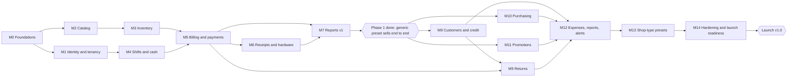

# Plan

The planned order of work from an empty repository to launch, for the four-person team (two backend, two frontend). Task status is tracked in **GitHub Issues and the GitHub Project** (one issue per task ID); the task files (`docs/tasks/<LANE>.md`) hold the specification. This page shows the order, the dependencies, the gates (with their state) and the exit criteria. A milestone is done when all four of its task issues are closed in the GitHub Project.

**Launch scope (D-021):** Phases 1 and 2 of `REQUIREMENTS.md` complete for all four shop-type presets (generic, grocery, pharmacy, clothing). Phase 3 and the deferred items come after launch (section 10).

**Sizes** are relative, to be re-estimated by the team after M0. S = about 1 to 2 weeks for a lane, M = 3 to 4 weeks, L = 5 weeks or more. No calendar dates are promised here.

**Task IDs** are `<lane prefix>-<milestone number>`, for example `B1-05` is BE1's work in milestone M5. A "session" is one Claude Code conversation: start a fresh one per task (type `/clear`).

---

## 1. Team lanes

Names are placeholders. Fill in the people.

| Member | Lane | Task file | IDs | Owns |
|---|---|---|---|---|
| **BE1** | Core and transactions | [BE1.md](tasks/BE1.md) | B1-00 to B1-14 | Infrastructure, tenancy, auth, shifts, billing, payments, returns, promotions, background jobs, security and performance |
| **BE2** | Catalog, stock and back office | [BE2.md](tasks/BE2.md) | B2-00 to B2-14 | Catalog, inventory, customers, purchasing, reports, shop-type presets, backup, export and data import |
| **FE1** | Terminal (cashier-facing) | [FE1.md](tasks/FE1.md) | F1-00 to F1-14 | POS screen, shifts, payments, receipts and hardware, returns at the counter, customer attach, promotions at the counter, draft-bill safety |
| **FE2** | Admin and back office | [FE2.md](tasks/FE2.md) | F2-00 to F2-14 | Design system, login and admin screens, catalog, inventory, customers, purchasing, reports, settings, shop-type forms |

Hardware work (printers, scanner, cash drawer, scale) belongs to FE1 with BE1 support.

## 2. Working agreements

- **Contract first.** Before a backend endpoint group is built, BE publishes its OpenAPI schema (drf-spectacular, committed). FE generates its API client from it and works against a mock until the real endpoint lands. A contract change needs a heads-up to the other lane and a schema update in the same pull request.
- **Cross-review.** BE1 and BE2 review each other's migrations and RLS policies. FE1 and FE2 review each other's shared components. At least one review per pull request.
- **Integration:** one short branch per task off `main`, merged by pull request after review and a green CI. CD deploys from `main`; frontend and backend deploy independently (D-022).
- **Definition of done** for every task: code, tests, OpenAPI schema updated, docs updated (`ER-DIAGRAM.md`, `DATA-DICTIONARY.md`, `DECISIONS.md` where relevant), and the pull request closing the task's GitHub issue.
- **CI gates:** tests pass, every shop-owned table has RLS enabled and forced, no app imports another app's models, schema file is up to date, lint passes.
- **Every new tenant table** ships with its RLS policy, a `shop_id`-first index and a cross-shop isolation test (see `CLAUDE.md`).
- **Demo at the end of each milestone.** The exit criteria below are the demo script.
- **Shop-type check.** Every feature is reviewed against all four presets, never one (D-021).

## 3. Decision gates

These open questions block specific milestones. Answer them before the milestone starts and record the answer in `DECISIONS.md`.

| Gate | Question | Needed before | State |
|---|---|---|---|
| G1 | Next.js rendering mode and UI libraries | M0 (FE) | answered (D-023); UI library: shadcn/ui |
| G2 | Confirm: one shop is one legal entity with one BIN; PIN is per shop; customers are per shop; session lifetime and idle-timeout values | M1 | answered (D-024) |
| G3 | Default negative-stock policy. Are branch operations (stock transfer FR-I-06, branch restriction FR-T-05, cross-shop owner view FR-T-08, FR-B-01 to FR-B-03) part of launch? | M3 | answered (D-025) |
| G4 | VAT rounding rule (per line or per bill). Bill number format and reset rule | M5 | answered (D-026): branch and register bill numbers; VAT rounded once per bill, half up to a whole taka |
| G5 | Delivery format for Windows desktop and Android tablet (browser, installable web app or wrapper) and the receipt-printing approach (browser print, local print agent, or other) | M6 | answered (D-027); validate on a real printer at the start of F1-06 |
| G6 | Launch-risk check with real shops: is fiscal device (EFD/SDC) support required? Offline selling is out of scope (D-028). Start talking to shops from M5 | M14 | open |

Mark a gate **answered** in the State column when it is decided, and record the answer in `DECISIONS.md`.

**Known risks**
- No code exists yet, so the design is untested. Expect small changes to the docs during M0 to M2.
- Offline selling is out of scope (D-028). Selling needs an internet connection, so shops with unreliable internet are outside the launch audience.
- Constraints that Django cannot express (RLS, "same shop" references, ledger protection) live in raw SQL migrations and need careful review.
- Task sizes are estimates until M0 gives real velocity.

## 4. Dependency map

M1 and M2 run in parallel. M8, M10 and M11 run in parallel after Phase 1.

## 5. Milestone overview

| # | Milestone | Main FR / NFR | Size | Gate |
|---|---|---|---|---|
| M0 | Foundations | NFR-13, NFR-14 setup | M | G1 |
| M1 | Identity, tenancy and admin | FR-T, FR-CFG-01 to 04, FR-ST-01, 03, 04, 05, NFR-05, 06, 17 | L | G2 |
| M2 | Catalog and pricing | FR-PR-01 to 07, FR-CFG-03 | L | |
| M3 | Inventory | FR-I-01 to 05, 07, 08, FR-RP-06 | L | G3 |
| M4 | Shifts and cash | FR-SH-01 to 03, 05, FR-T-07 | M | |
| M5 | Billing and payments | FR-S-01 to 06, 12, 13, FR-P-01 to 04, FR-ST-02, NFR-15, 16 | L | G4 |
| M6 | Receipts and hardware | FR-S-08 to 11, FR-PR-03 (printing), NFR-11 | M | G5 |
| M7 | Reports v1 | FR-RP-01, 02, 06 | S | |
| M8 | Customers, credit, loyalty | FR-C-01 to 05, FR-S-07, FR-P-05, 06 | L | |
| M9 | Returns and exchanges | FR-R-01 to 05 | M | |
| M10 | Suppliers and purchasing | FR-PU-01 to 06 | L | |
| M11 | Promotions and coupons | FR-D-01 to 04 | M | |
| M12 | Expenses, reports, alerts | FR-SH-04, FR-RP-03 to 09, FR-N-01, FR-I-03 | L | |
| M13 | Shop-type presets | FR-CFG-05 | M | |
| M14 | Hardening and launch readiness | NFR-01, 02, 07, 08, 09, 10, 12, 13 | L | G6 |

---

## 6. Waves

A task can start as soon as its milestone dependencies are met (see the dependency map). Inside a wave, lanes work in parallel.

| Wave | BE1 | BE2 | FE1 | FE2 |
|---|---|---|---|---|
| 1 Foundation | B1-00 | B2-00 | F1-00 | F2-00 |
| 2 Platform | B1-01, B1-02, B1-03, B1-04 | B2-01, B2-02, B2-03, B2-04 | F1-01, F1-02, F1-03, F1-04 | F2-01, F2-02, F2-03, F2-04 |
| 3 Sell | B1-05, B1-06, B1-07 | B2-05, B2-06, B2-07 | F1-05, F1-06, F1-07 | F2-05, F2-06, F2-07 |
| 4 Back office | B1-08, B1-09, B1-10, B1-11, B1-12 | B2-08, B2-09, B2-10, B2-11, B2-12 | F1-08, F1-09, F1-10, F1-11, F1-12 | F2-08, F2-09, F2-10, F2-11, F2-12 |
| 5 Presets and launch | B1-13, B1-14 | B2-13, B2-14 | F1-13, F1-14 | F2-13, F2-14 |
| 6 Prove | TM-01 to TM-04 (whole team) | | | |

**Critical path (do these fast):** B1-00 → B1-01 → B1-04 → B1-05, with B2-02 → B2-03 → B1-05. M5 needs both shifts (M4) and inventory (M3). If someone is blocked, others help on the critical path. Waiting on someone? Work on the next task that is not blocked, or build against mocks and fixtures.

## 7. Milestone goals and exit criteria

These are the demo scripts for the end of each milestone. Work per member is in the task files.

### M0: Foundations
**Goal:** a working skeleton on both sides, talking to each other, with the safety rails in place before any feature work.
**Depends on:** G1.
**Exit criteria:** CI is green on both repos or folders. A stub login reaches a `/me` endpoint through the Next.js proxy. The RLS coverage test fails on a table without RLS and passes otherwise. A cross-shop read test passes (it fails to read).
**Tasks:** [B1-00](tasks/BE1.md), [B2-00](tasks/BE2.md), [F1-00](tasks/FE1.md), [F2-00](tasks/FE2.md)

### M1: Identity, tenancy and admin
**Goal:** shops, owners, staff and sessions work as designed, and a platform admin can create a shop from a preset.
**Depends on:** M0, G2. **Requirements:** FR-T-01 to 04, 06, 09, 10, FR-CFG-01 to 04, FR-ST-01, 03, 04, 05, NFR-05, 06, 17.
**Exit criteria:** tenant isolation tests pass through the real API. A shop with two owners works and removing the last owner is blocked. A platform admin creates a new shop of each preset and its owner can log in. Revoking a session or removing a membership fails the next request.
**Tasks:** [B1-01](tasks/BE1.md), [B2-01](tasks/BE2.md), [F1-01](tasks/FE1.md), [F2-01](tasks/FE2.md)

### M2: Catalog and pricing
**Goal:** products for every shop type, with search that is fast on Bangla names.
**Depends on:** M0. Can run in parallel with M1. **Requirements:** FR-PR-01 to 07, FR-CFG-03.
**Exit criteria:** a product with variants, barcodes and unit conversions can be created in all four presets with their custom fields and no backend change. Search over 50,000 products returns within 1 second. Import round-trips a product file.
**Tasks:** [B1-02](tasks/BE1.md), [B2-02](tasks/BE2.md), [F1-02](tasks/FE1.md), [F2-02](tasks/FE2.md)

### M3: Inventory
**Goal:** stock that is always explainable from the ledger.
**Depends on:** M2, G3. **Requirements:** FR-I-01 to 05, 07, 08 (weighted average), FR-RP-06.
**Exit criteria:** rebuilding `stock_levels` from `stock_movements` gives the same numbers. Two simultaneous adjustments never corrupt stock. A batch-tracked item is picked first-expiring-first-out. Updates and deletes on `stock_movements` are rejected by the database.
**Tasks:** [B1-03](tasks/BE1.md), [B2-03](tasks/BE2.md), [F1-03](tasks/FE1.md), [F2-03](tasks/FE2.md)

### M4: Shifts and cash
**Goal:** cash accountability per register and per cashier.
**Depends on:** M1. **Requirements:** FR-SH-01 to 03, 05, FR-T-07.
**Exit criteria:** a cashier works shifts in two branches and two shops one after the other, each with its own opening cash and Z-report. A second open shift for the same user or register is refused. The cash difference is correct. A closed shift and its Z-report cannot be changed.
**Tasks:** [B1-04](tasks/BE1.md), [B2-04](tasks/BE2.md), [F1-04](tasks/FE1.md), [F2-04](tasks/FE2.md)

### M5: Billing and payments
**Goal:** the core sale, fast and safe. This is the heart of the product.
**Depends on:** M3, M4, G4. **Requirements:** FR-S-01 to 06, 12, 13, FR-P-01 to 04, FR-ST-02, NFR-15, 16.
**Exit criteria:** a 10-item bill completes within 30 seconds by an average user. Sending the same sale twice creates one bill. Stock, payments and shift totals always agree after concurrent sales. A void works only while the shift is open and writes reversing entries. A refreshed browser keeps the bill in progress.
**Tasks:** [B1-05](tasks/BE1.md), [B2-05](tasks/BE2.md), [F1-05](tasks/FE1.md), [F2-05](tasks/FE2.md)

### M6: Receipts and hardware
**Goal:** the physical counter works.
**Depends on:** M5, G5. **Requirements:** FR-S-08 to 11, FR-PR-03 (label printing), NFR-11.
**Exit criteria:** a bill prints correctly in Bangla and English on both paper widths. The cash drawer opens on print. A reprint is marked duplicate. Scanned barcodes add the right item.
**Tasks:** [B1-06](tasks/BE1.md), [B2-06](tasks/BE2.md), [F1-06](tasks/FE1.md), [F2-06](tasks/FE2.md)

### M7: Reports v1
**Goal:** the owner sees the day. Completes Phase 1.
**Depends on:** M5, M6. **Requirements:** FR-RP-01, 02, 06.
**Exit criteria:** at the end of a day the stock report and sales report reconcile 100%. The generic preset runs the whole flow: set up shop, add products, receive opening stock, open shift, sell, close shift, read the reports. A cashier cannot see profit.
**Tasks:** [B1-07](tasks/BE1.md), [B2-07](tasks/BE2.md), [F1-07](tasks/FE1.md), [F2-07](tasks/FE2.md)

### M8: Customers, credit and loyalty
**Goal:** repeat customers, credit sales and points.
**Depends on:** Phase 1. **Requirements:** FR-C-01 to 05 (list), FR-S-07, FR-P-05, 06.
**Exit criteria:** customer balance equals the sum of its ledger. A credit sale over the limit needs approval. Points earn and redeem correctly. A due payment reduces the balance and appears in the shift's cash.
**Tasks:** [B1-08](tasks/BE1.md), [B2-08](tasks/BE2.md), [F1-08](tasks/FE1.md), [F2-08](tasks/FE2.md)

### M9: Returns and exchanges
**Goal:** safe returns with correct stock and money.
**Depends on:** M5, M8. **Requirements:** FR-R-01 to 05.
**Exit criteria:** a return after the shift closed works as a return, not a void. Damaged items never re-enter sellable stock. Return outside the window is refused or needs approval.
**Tasks:** [B1-09](tasks/BE1.md), [B2-09](tasks/BE2.md), [F1-09](tasks/FE1.md), [F2-09](tasks/FE2.md)

### M10: Suppliers and purchasing
**Goal:** stock comes in properly with cost, batch, expiry and purchase VAT.
**Depends on:** Phase 1 (needs M3). **Requirements:** FR-PU-01 to 06.
**Exit criteria:** a partial receipt updates the order status and stock. Supplier balance equals its ledger. Average cost updates correctly. Purchase VAT is recorded for the VAT report.
**Tasks:** [B1-10](tasks/BE1.md), [B2-10](tasks/BE2.md), [F1-10](tasks/FE1.md), [F2-10](tasks/FE2.md)

### M11: Promotions and coupons
**Goal:** discounts the shop can plan.
**Depends on:** Phase 1. **Requirements:** FR-D-01 to 04.
**Exit criteria:** several offers on one bill apply in the set order. A non-stackable offer stops the chain. Coupon usage limits hold under concurrent use.
**Tasks:** [B1-11](tasks/BE1.md), [B2-11](tasks/BE2.md), [F1-11](tasks/FE1.md), [F2-11](tasks/FE2.md)

### M12: Expenses, reports and alerts
**Goal:** the remaining reports and the alert system. Completes Phase 2 features.
**Depends on:** M8, M9, M10, M11. **Requirements:** FR-SH-04, FR-RP-03 to 09, FR-N-01, FR-I-03.
**Exit criteria:** an expiring batch raises an alert before the set number of days. The VAT report matches a hand-checked month. Reports export to PDF and Excel. Profit and loss matches sales minus cost minus expenses.
**Tasks:** [B1-12](tasks/BE1.md), [B2-12](tasks/BE2.md), [F1-12](tasks/FE1.md), [F2-12](tasks/FE2.md)

### M13: Shop-type presets
**Goal:** each of the four presets passes its end-to-end scenario with no shop-type code.
**Depends on:** M2 to M12. **Requirements:** FR-CFG-05.
**Exit criteria:** all four acceptance scenarios pass: generic, grocery (weighed item, carton to piece, combo), pharmacy (batch, expiry, first-expiring-first-out, expiry alert), clothing (variants, return). A fifth, new preset can be added with data only.
**Tasks:** [B1-13](tasks/BE1.md), [B2-13](tasks/BE2.md), [F1-13](tasks/FE1.md), [F2-13](tasks/FE2.md)

### M14: Hardening and launch readiness
**Goal:** safe to put in front of paying shops.
**Depends on:** M13, G6. **Requirements:** NFR-01, 02, 07, 08, 09, 10, 12, 13.
**Exit criteria:** all MVP and launch acceptance criteria in `REQUIREMENTS.md` section 9 pass. Load targets are met. A restore drill and a per-shop export succeed. UAT sign-off from at least one real shop per preset.
**All members:** user acceptance testing with real shops of each type, fixes, and the G6 decision on fiscal device support.
**Tasks:** [B1-14](tasks/BE1.md), [B2-14](tasks/BE2.md), [F1-14](tasks/FE1.md), [F2-14](tasks/FE2.md)

## 8. Team tasks (Wave 6)

- **TM-01** Fresh-clone check: on a different PC, clone the repo and run the setup from `SETUP.md`; the stack must start from zero and the smoke script below must pass · lead **BE1**
- **TM-02** Evidence: record the isolation, load, restore and failure-matrix results in `docs/results/` (create the folder when the first evidence exists; the failure matrix is in `ARCHITECTURE.md`) · lead **BE2**
- **TM-03** User acceptance with real shops, one per preset (generic, grocery, pharmacy, clothing) · lead **FE2**
- **TM-04** Demo and training material: rehearse the smoke script and write the 30-minute cashier training guide · lead **FE1**

### Smoke script (also used for regression testing)

1. A platform admin creates a shop from a preset and assigns its first owner.
2. The owner logs in, adds a branch, a register, a cashier and a manager.
3. The owner adds products (with variants, units and custom fields for the preset) and enters opening stock.
4. The cashier logs in on the register with a PIN and opens a shift with opening cash.
5. The cashier sells: a normal item, a weighed or batch item where the preset has them, a split payment, and a held bill that is recalled.
6. The cashier takes a return after a sale, and a manager approves a discount above the cashier's limit.
7. The cashier closes the shift; the Z-report shows the correct cash difference.
8. The owner reads the dashboard and the sales and stock reports, and they reconcile with the sales made.
9. A second shop's user tries to read the first shop's data and fails.

## 9. Requirement coverage check

Every launch requirement from `REQUIREMENTS.md` has a milestone.

| Requirements | Milestone |
|---|---|
| FR-T-01 to 04, 06, 09, 10 | M1 |
| FR-T-05 | M1 |
| FR-T-07 | M4 |
| FR-B-01, 02 | M1 (branches, registers, member restriction), M2 (branch prices), M3 (branch stock) |
| FR-B-03 (per branch) | M7, M12 (branch filters on reports) |
| FR-CFG-01 to 04 | M1 (presets seeded), M2 (custom fields) |
| FR-CFG-05 | M13 |
| FR-S-01 to 06, 12, 13 | M5 |
| FR-S-07 | M8 |
| FR-S-08 to 11 | M6 |
| FR-P-01 to 04 | M5 |
| FR-P-05, 06 | M8 |
| FR-PR-01, 02, 04, 05, 06, 07 | M2 |
| FR-PR-03 | M2 (generation), M6 (printing) |
| FR-I-01, 02, 04, 05, 07, 08 | M3 |
| FR-I-03 | M3 (queries), M12 (alerts) |
| FR-C-01 to 05 | M8 |
| FR-PU-01 to 06 | M10 |
| FR-R-01 to 05 | M9 |
| FR-D-01 to 04 | M11 |
| FR-SH-01 to 03, 05 | M4 |
| FR-SH-04 | M12 |
| FR-RP-01, 02, 06 | M7 (stock data from M3) |
| FR-RP-03 to 05, 07 to 09 | M12 |
| FR-ST-01, 03, 04, 05 | M1 |
| FR-ST-02 | M5 |
| FR-N-01 | M12 |
| NFR-05, 06, 14, 17 | M0 and M1, checked again in M14 |
| NFR-15, 16 | M5 |
| NFR-01, 02, 07, 08, 09, 10, 12, 13 | M14, with early checks in M2, M5 and M6 |
| NFR-11 | M6 (delivery format, G5) |

## 10. After launch

| Item | Notes |
|---|---|
| Stock transfers (FR-I-06), the cross-shop owner view (FR-T-08), branch overrides of settings (FR-ST-06) | Post-launch (D-025). Per-branch stock, prices, member restriction and per-branch reports are in launch. |
| FIFO stock valuation (FR-I-08) | Phase 3 |
| Owner mobile app, e-commerce and accounting integration, advanced analytics | Phase 3 |
| SMS and email sending (FR-N-02) | Deferred (D-015). First candidate to split into its own service. |
| Offline selling and sync (NFR-03) | Out of scope until after launch (D-028). |
| Fiscal device integration (NFR-12) | Prepared only. Re-check with G6. |
| Restaurant module | Not defined |

## 11. Keeping this plan current

- Change this file only when scope, order, gates or ownership change. Task progress is tracked in GitHub Issues and the GitHub Project.
- When a gate is answered, record the answer in `DECISIONS.md` and mark the gate answered in section 3.
- After M0, re-estimate sizes with real velocity and update section 5 and the sizes in the task files.